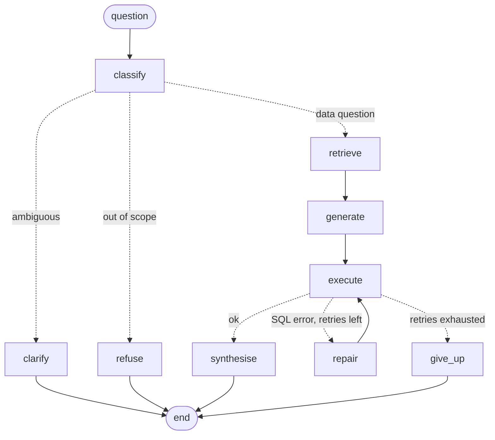

# nl-analytics-agent

A text-to-SQL agent over Formula 1 data, built as a production-style system rather than a notebook: a LangGraph state machine, hybrid schema retrieval in pgvector, three independent layers that keep the database read-only, Langfuse tracing, a benchmark with an accuracy gate in CI, and an adversarial test suite. It is exposed as an MCP server for Claude Code and Cursor.

The database is [f1db](https://github.com/f1db/f1db), the maintained successor of the Ergast F1 dataset: 31 tables, 17 views, 699 columns, 1,172 races from 1950 to 2026. Its `race_data` table holds every kind of per-driver result in one wide table keyed by a `type` column, which makes schema retrieval a real problem rather than a toy one.

## Status

| Milestone | State |
|---|---|
| Read-only safety, MCP server, benchmark, four baseline configs | Built and tested |
| M1 LangGraph rebuild | Built and measured. The default graph scores 83.9% against 87.5% for the best baseline, so the acceptance bar is missed by two questions. The graph with hybrid retrieval and no reranker scores 92.9%. Differences are within noise at 56 questions. See [RESULTS.md](RESULTS.md) |
| M2 Retrieval layer | Built and measured. See [RESULTS.md](RESULTS.md) |
| M3 Observability | Built and unit tested. Langfuse compose file included. Not yet run against a live Langfuse server |
| M4 Evals in CI | Built. Judge agreement measured (20 of 20, on an easy label set). The PR gate has a committed baseline and is off until the Google key has credit (see CI) |
| M5 Guardrails | Built and tested. 17 compromised-LLM attacks and 5 injection phrases all stopped |
| M6 Failure taxonomy | Done. Counts per configuration and three worked examples are in [FAILURES.md](FAILURES.md) |
| M7 Multi-agent comparison | Not started (optional in the spec) |

Every accuracy, latency and cost figure here was measured, with `gemini-3-flash-preview`, one run per configuration. Anything not yet measured is marked as such. `make eval-all` reproduces the baseline and graph runs.

## How a question flows



The generated diagram is in [docs/graph.mmd](docs/graph.mmd) (`make graph-diagram`). Every node writes a record with its latency, tokens and errors, and those records become the Langfuse trace.

Around the graph, `Agent.ask` applies a per-user rate limit, input checks for injection phrases, and output checks for leaked secrets or prompt text.

## Keeping the database read-only

A write must get past all three layers, and each is tested on its own in `tests/test_db_safety.py`:

1. **SQL guard** (`guard.py`). sqlglot parses the query. Only one `SELECT` over the allowed tables passes. Write statements, stacked statements, writes hidden in a CTE, system catalogs, `FOR UPDATE` locks and any function outside a short allowlist (so `pg_sleep`, `set_config`, `version` and the XML export helpers) are rejected.
2. **Database role** (`scripts/setup_roles.sql`). The role `agent_ro` can only `SELECT`. It cannot `DELETE` or `CREATE` even if the guard is bypassed.
3. **Session limits** (`db.py`). Each connection is read-only with a statement timeout, and results are cut at a row cap.

`tests/test_adversarial.py` goes further: it replaces the LLM with a stub that does exactly what an attacker asks (`DROP TABLE`, reading `pg_shadow`, switching off read-only mode) and checks that nothing reaches the database and the table counts do not change.

## Quick start

Requires Docker. Python runs inside a container, which keeps the setup identical on Windows ARM, Linux and CI.

```bash
make up                 # Postgres 16 + pgvector on port 5433
make load-data          # download f1db, load it, create the read-only role, embed the columns
make test               # no API key needed
make retrieval-eval     # schema retrieval recall, no API key needed
```

With an API key:

```bash
export ANTHROPIC_API_KEY=...
make eval-all           # the four baseline configs and the graph, JSON reports in reports/
make judge-eval         # LLM judge agreement against the hand labels
```

Any OpenAI-compatible server also works: set `LLM_PROVIDER=openai`, `LLM_BASE_URL` and `LLM_MODEL`.

## Benchmark and baseline

`benchmark/questions.yaml` holds 56 questions (20 easy, 24 medium, 12 hard) with gold SQL. Every gold query was executed and its output inspected. A second person has not yet reviewed the answers, so treat it as verified by execution, not independently hand-verified. Scoring is execution accuracy: the predicted result must equal the gold result, ignoring row order unless the question needs an order.

This is a rebuild, so the four ablation configurations are defined in `baseline.py`, each adding one thing to the last:

| Config | Schema in prompt | Few-shot | Repair loop |
|---|---|---|---|
| `full_schema` | all 699 columns | no | no |
| `retrieved` | vector retrieval, top 25 | no | no |
| `retrieved_fewshot` | vector retrieval, top 25 | yes | no |
| `retrieved_fewshot_repair` | vector retrieval, top 25 | yes | up to 2 retries |

The graph (`--config graph`) uses hybrid retrieval with a reranker, few-shot examples, the repair loop, intent classification and answer synthesis.

## Tracing with Langfuse

```bash
cd observability/langfuse
cp .env.example .env
docker compose up -d      # UI on http://localhost:3000
```

Then export `LANGFUSE_HOST=http://localhost:3000`, `LANGFUSE_PUBLIC_KEY=pk-lf-f1-agent-local` and `LANGFUSE_SECRET_KEY=sk-lf-f1-agent-local`. Each question becomes one trace with a span per node; LLM nodes are recorded as generations with tokens and cost. Tracing is best effort: if Langfuse is down the answer still returns. `observability/langfuse/docker-compose.yml` is the upstream Langfuse file with only the init keys supplied through `.env`.

## Use it from Claude Code or Cursor

```bash
claude mcp add f1-analytics -- docker compose -f /path/to/nl-analytics-agent/docker-compose.yml \
  --profile tools run --rm -T app python -m nlagent.mcp_server
```

For Cursor, add the same command and arguments to `mcp.json`. Tools: `ask_f1` (needs a key), `run_sql` and `describe_schema` (no key needed).

## CI

`ci.yml` runs lint and the full test suite against a real Postgres on every pull request, using the stub LLM, so it needs no secret. `eval.yml` runs a fixed 20-question subset with a spend cap of $1.00 and fails the check if accuracy falls more than 10 points below `benchmark/ci_baseline.json` (75%, 15 of 20, measured on `gemini-3-flash-preview`). It calls Google AI Studio's OpenAI-compatible endpoint with the repository secret `GOOGLE_API_KEY`, and runs only when the repository variable `EVAL_ENABLED` is `true`. That variable is currently `false` because the key's prepaid credits ran out. To switch it on, top up the key, set `EVAL_ENABLED=true`, and rewrite the baseline after any intentional change with `python -m nlagent.regression --report reports/pr.json --baseline benchmark/ci_baseline.json --write-baseline`. One question is 5 points on a 20 question subset, so the 10 point threshold tolerates two lost questions and a rerun can cross it by chance.

## Limitations

- The benchmark is small (56 questions) and written by one author, so differences of a few points are noise.
- The failure classifier is rule-based on SQL structure and will mislabel some cases. FAILURES.md is meant to be read with the examples.
- The input guard is a phrase filter and is easy to rephrase around. It is a cheap first filter. The read-only layers are the real boundary.
- The rate limiter keeps state in memory, so it applies per process.
